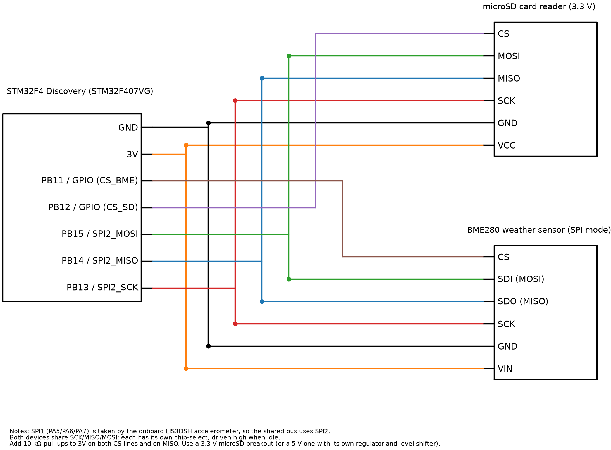

# spiproj

[](https://github.com/RajaSrinivasan/spiproj/actions/workflows/build.yml)

Ada firmware for the STM32F4 Discovery board (STM32F407VG). A microSD card
reader and a BME280 weather sensor share SPI2. `weather_logger` also prints
each sample on USART2. A bootloader in the first 384 KiB of flash looks for
a file named `bootstrap` on that card and, when the file is a valid image,
replaces the application. The sources use AdaCore's
[Ada_Drivers_Library](https://github.com/AdaCore/Ada_Drivers_Library) and the
`embedded-stm32f4` GNAT ARM ELF runtime.

SPI1 (PA5, PA6, PA7) is already used by the board's LIS3DSH accelerometer, so
the external devices sit on SPI2. Both devices share SCK, MISO, and MOSI.
Each has its own chip-select, held high when idle.

## Wiring

| Signal     | Pin  | Setup                                              |
|------------|------|----------------------------------------------------|
| SPI2 SCK   | PB13 | Alternate function AF5 (`GPIO_AF_SPI2_5`)          |
| SPI2 MISO  | PB14 | Alternate function AF5                             |
| SPI2 MOSI  | PB15 | Alternate function AF5                             |
| microSD CS | PB12 | Push-pull GPIO output, idle high                   |
| BME280 CS  | PB11 | Push-pull GPIO output, idle high                   |
| USART2 TX  | PA2  | Alternate function AF7 (`GPIO_AF_USART2_7`)        |
| USART2 RX  | PA3  | Alternate function AF7                             |
| GND        | GND  | Common ground with the USB-UART adapter            |

Power both breakouts from 3.3 V and GND. Put 10 kΩ pull-ups to 3.3 V on both
chip-selects and on MISO. Use a 3.3 V microSD breakout, or a 5 V breakout that
has its own regulator and level shifter.

Connect a 3.3 V USB-UART adapter for the serial log: adapter RX to PA2
(USART2_TX), adapter TX to PA3 (USART2_RX), and adapter GND to board GND.
The STM32F407 pins are not 5 V tolerant. Do not use a 5 V USB-UART adapter.

PA2 and PA3 are free on the Discovery. The user button is PA0, the LEDs are
PD12–PD15, the LIS3DSH uses SPI1 (PA5, PA6, PA7, PE3), the audio codec uses
PA4, PB6, PB9, PC7, PC10, PC12, and PD4, USB uses PA9, PA11, and PA12, and
the microphone uses PB10 and PC3. USART1 TX would land on PA9, and USART6
shares PC7 with the audio clock, so the log uses USART2. The on-board ST-LINK
has no virtual COM port; the adapter is a separate dongle.



SPI2 comes up as a mode 0 master, 8-bit, MSB first, with software-managed NSS.
The baud prescaler starts at `BRP_128` (about 328 kHz when APB1 is 42 MHz),
which is slow enough for SD card initialization. After `SD_SPI.Initialize`
succeeds it is raised to `BRP_4` (about 10.5 MHz) through `SPI_Bus.Set_Prescaler`.

`tools/draw.py` redraws the schematic with
[schemdraw](https://schemdraw.readthedocs.io/). From `docs/`:

```sh
python3 ../tools/draw.py
```

That writes `stm32f4_spi_schematic.png` in the current directory. The copy
checked in above is `docs/stm32f4_spi_schematic.png`.

## Repository layout

```
spiproj.gpr                 project file (mains, runtime, library with)
src/spi_bus.ads/.adb        SPI2 pins, chip-selects, prescaler
src/sd_spi.ads/.adb         SD card over SPI (HAL.Block_Drivers.Block_Driver)
src/sd_volume.ads/.adb      FAT mount shared by the logger and the bootloader
src/bme280.ads/.adb         BME280 driver (temperature, pressure, humidity)
src/read_bme280_id.adb      main: chip-id check
src/demo_spi2.adb           main: sensor read and SD block round-trip
src/serial_log.ads/.adb     USART2 text log (115200 8N1, CR LF)
src/flash_crc.ads/.adb      STM32 CRC-32 of .text, .rodata, and .data in flash
src/stm32_crc.ads/.adb      that CRC, as a byte stream, for both programs
src/flash_layout.ads/.adb   bootloader and application windows
src/internal_flash.ads/.adb erase and program the application window
src/bootstrap_image.ads/.adb  32-byte header and vector checks
src/app_jump.ads/.adb       branch into the application
src/bootloader.adb          main: SD bootstrap, then the application
src/weather_logger.adb      main: CSV log, USART2, and periodic CRC check
ld/layout_symbols.ld        flash window addresses
ld/boot_rom.ld              bootloader link (sectors 0-6)
ld/app_rom.ld               application link (sectors 7-11)
ld/sections.ld              SECTIONS block shared by both links
ld/section_symbols.ld       linker symbols for the CRC ranges
docs/stm32f4_spi_schematic.png
tools/draw.py
tools/elf_hashes.py         same CRC-32, computed from an ELF file
tools/bootstrap_image.py    pack and check a bootstrap file
lib/Ada_Drivers_Library/    git submodule
```

`obj/` and `bin/` are build outputs. Application objects go to `obj/app`,
bootloader objects to `obj/boot`.

## Packages

- `SPI_Bus` sets up the pins and chip-selects and changes the SPI2 prescaler.
  `STM32.SPI` has no baud-only update, so `Set_Prescaler` disables the port,
  calls `STM32.SPI.Configure` again, and re-enables it.
- `SD_SPI` initializes an SD card in SPI mode (CMD0, CMD8, ACMD41, CMD58,
  CMD16), then reads and writes single 512-byte blocks (CMD17 and CMD24).
  Commands carry a CRC7. `SD_Card` extends `HAL.Block_Drivers.Block_Driver`,
  so `Card'Access` can be passed to `Filesystem.FAT.Open`. The library itself
  has no SPI-mode SD driver. The closest pieces are the SDIO controller in
  `STM32.SDMMC` / `HAL.SDMMC` and the `SDCard` board helper, which is wired
  for other boards.
- `SD_Volume` mounts that card: the first FAT partition, or LBA 0 when there
  is no MBR. The volume name is `sd`. `weather_logger` and the bootloader
  both use it.
- `Serial_Log` brings up USART2 on PA2 (TX) and PA3 (RX) at 115200 8N1 and
  provides `Put` and `Put_Line`. `Put_Line` appends CR LF. It uses
  `STM32.USARTs` and `STM32.Device` (`USART_2`, `GPIO_AF_USART2_7`).
- `Flash_CRC` hashes three flash images with the STM32F4 CRC unit
  (`STM32.CRC` / `CRC_Unit`): `.text`, `.rodata`, and the load image of
  `.data`. The bounds are the linker symbols in `ld/section_symbols.ld`
  (`__text_start` / `__text_end`, `__rodata_start` / `__rodata_end`,
  `__data_lma_start` / `__data_lma_end`). This is a corruption check. It is
  not a cryptographic hash.
- `BME280` is a standalone driver. Ada_Drivers_Library ships `BMP280` only,
  and that package does not implement humidity and only checks that the
  chip-id is non-zero. This driver requires chip-id `16#60#`, reads the
  humidity calibration (H1 at `16#A1#`, H2–H6 at `16#E1#` .. `16#E7#`), and
  applies Bosch's integer humidity compensation (Q22.10 %RH) along with the
  library's temperature and pressure formulas. Chip-select is PB11.

## Prerequisites

- A GNAT ARM ELF toolchain (`arm-eabi`) that provides the `embedded-stm32f4`
  runtime, and `gprbuild`. These sources were built with GNAT 15.3.0 ARM ELF.
  Prebuilt archives are on the
  [GNAT-FSF-builds](https://github.com/alire-project/GNAT-FSF-builds/releases)
  releases: `gnat-arm-elf-linux64-x86_64-15.3.0-1.tar.gz` from
  `gnat-15.3.0-1`, and a host `gprbuild-*-linux-*.tar.gz` from a `gprbuild-*`
  release. Unpack both and put each `bin` directory on `PATH`.
- Or [Alire](https://alire.ada.dev/). This repository is a plain GPR project.
  Alire is only needed as a way to install the same tools, for example
  `alr install gnat_arm_elf gprbuild`, which places them under `~/.alire`.

Fetch the library submodule (once per clone):

```sh
git submodule update --init --recursive
```

`git clone --recurse-submodules` does the same thing at clone time.

The `with` in `spiproj.gpr` is a relative path to
`lib/Ada_Drivers_Library/boards/stm32f407_discovery/stm32f407_discovery_full.gpr`.
If the library is checked out somewhere else, edit that one line.

## Build

From the repository root, with `gprbuild` and `arm-eabi-gcc` / `arm-eabi-gnat`
on `PATH`. The runtime's own linker script pins all of flash at `0x08000000`,
so every build passes `-XLOADER=USER` and supplies `ld/app_rom.ld` or
`ld/boot_rom.ld` instead. `make` does both:

```sh
make
```

The same two steps without make:

```sh
gprbuild -P spiproj.gpr -XLOADER=USER -XIMAGE=app
gprbuild -P spiproj.gpr -XLOADER=USER -XIMAGE=boot
```

`IMAGE=app` is the default. It builds `weather_logger`, `demo_spi2`, and
`read_bme280_id`, linked at `0x08060000`. `IMAGE=boot` builds `bootloader`,
linked at `0x08000000`. Object files go to `obj/app` or `obj/boot`. The ELF
images go to `bin/` with those names and no extension. To build one
application main:

```sh
gprbuild -P spiproj.gpr -XLOADER=USER weather_logger.adb
gprbuild -P spiproj.gpr -XLOADER=USER demo_spi2.adb
gprbuild -P spiproj.gpr -XLOADER=USER read_bme280_id.adb
```

The link passes `--gc-sections`. Unused library routines are dropped, which
is what keeps the bootloader inside its 384 KiB window. The link fails if an
image grows past the window in `ld/layout_symbols.ld`.

## CI

[`.github/workflows/build.yml`](.github/workflows/build.yml) builds the
bootloader and the three application mains on every push, on pull requests,
and when the workflow is dispatched by hand. The job downloads the GNAT FSF
ARM ELF 15.3.0 toolchain and GPRbuild 25.0.0 from
[GNAT-FSF-builds](https://github.com/alire-project/GNAT-FSF-builds/releases)
(the same archives named above; the tarballs are cached between runs),
checks out `lib/Ada_Drivers_Library` with its submodules, and runs the two
`gprbuild` commands above. The images are uploaded as the `stm32f4-images`
artifact:

- `bootloader.elf` and `.bin`
- `weather_logger.elf`, `.bin`, and `.bootstrap`
- `demo_spi2.elf`, `.bin`, and `.bootstrap`
- `read_bme280_id.elf`, `.bin`, and `.bootstrap`
- `bootstrap`, a copy of `weather_logger.bootstrap` under the file name the
  card expects
- `weather_logger.crc32.txt`, `demo_spi2.crc32.txt`, and
  `read_bme280_id.crc32.txt`

The `.elf` files are the extensionless `bin/` programs with a suffix added.
The `.bin` files come from `arm-eabi-objcopy -O binary`. The `.bootstrap`
files come from `tools/bootstrap_image.py pack`. The job rejects an ELF
whose flash load address is outside its window, and it runs
`tools/elf_hashes.py` on each application ELF. Those lines are the STM32
CRC-32 a board should print as `REF` for that image. Both scripts'
`--self-test` checks run first.

## Flash layout

The STM32F407VG has 1 MiB of flash at `0x08000000`. Erase granularity is the
sector, so the two programs meet on a sector boundary.

| Region       | Sectors | Address      | Size    |
|--------------|---------|--------------|---------|
| Bootloader   | 0 .. 6  | `0x08000000` | 384 KiB |
| Application  | 7 .. 11 | `0x08060000` | 640 KiB |

Sectors 0-3 are 16 KiB, sector 4 is 64 KiB, and sectors 5-11 are 128 KiB.
The bootloader is linked at the reset address. Each application main is
linked with its vector table at `0x08060000`. The runtime sets `VTOR` from
that table during its own startup; the bootloader also points `VTOR` there
before the branch. The addresses are `ld/layout_symbols.ld`. The bootloader
reads the same symbols, so a link and the program that consumes it cannot
disagree.

The Discovery's on-board ST-LINK is the debug probe. The first time, write
both images. `st-flash write` and OpenOCD `program` erase the sectors covered
by that write, not the other window. Reset only after both are present: a
bootloader with a blank application window logs `app_invalid` and waits.

```sh
arm-eabi-objcopy -O binary bin/bootloader bin/bootloader.bin
arm-eabi-objcopy -O binary bin/weather_logger bin/weather_logger.bin
st-flash write bin/bootloader.bin 0x08000000
st-flash --reset write bin/weather_logger.bin 0x08060000
```

```sh
arm-eabi-objcopy -O binary bin/bootloader bin/bootloader.bin
arm-eabi-objcopy -O binary bin/weather_logger bin/weather_logger.bin
openocd -f board/stm32f4discovery.cfg \
  -c "init" \
  -c "program bin/bootloader.bin 0x08000000 verify" \
  -c "program bin/weather_logger.bin 0x08060000 verify reset exit"
```

OpenOCD can program the ELF files directly, at the addresses recorded in
them:

```sh
openocd -f board/stm32f4discovery.cfg \
  -c "init" \
  -c "program bin/bootloader verify" \
  -c "program bin/weather_logger verify reset exit"
```

Use `bin/demo_spi2` or `bin/read_bme280_id` in place of `bin/weather_logger`
for the application window. Later updates of the application go through the
SD card, below. Replacing the bootloader itself is a probe write to
`0x08000000`; the bootloader does not overwrite its own sectors.

`read_bme280_id` and `demo_spi2` report through the user LEDs.
`weather_logger` also writes a text log on USART2. The Discovery ST-LINK
has no virtual COM port.

## SD card bootstrap

On reset the bootloader brings up USART2, then the SD card. The file it
looks for is named `bootstrap`, with no extension, at the root of the FAT
volume (the path is `/sd/bootstrap`). The name is nine letters, so the
directory entry is a long file name. Copying it from Linux, macOS, or
Windows onto a FAT12, FAT16, or FAT32 card creates that entry.

The file is a 32-byte little-endian header plus the raw application image
from `arm-eabi-objcopy -O binary`. It is not an ELF. `tools/bootstrap_image.py`
writes the header. The payload CRC is the same STM32 CRC-32 as
`tools/elf_hashes.py`: a corruption check, not a signature.

| Offset | Size | Field                                      |
|--------|------|--------------------------------------------|
| 0      | 4    | ASCII `SPB1`                               |
| 4      | 4    | header length, 32                          |
| 8      | 4    | payload length                             |
| 12     | 4    | load address, must be `0x08060000`         |
| 16     | 4    | STM32 CRC-32 of the payload                |
| 20     | 4    | STM32 CRC-32 of bytes 0 .. 19              |
| 24     | 8    | reserved, zero                             |
| 32     | N    | payload, vector table at the first byte   |

Prepare a card that is already FAT (the logger does not format a blank
card). From the repository root, after `make`:

```sh
arm-eabi-objcopy -O binary bin/weather_logger weather_logger.bin
python3 tools/bootstrap_image.py pack weather_logger.bin bootstrap
```

Copy `bootstrap` to the card root, next to `WEATHER.CSV` if that file is
already there. Insert the card and reset. The bootloader checks the header,
the payload CRC, and the vector table before it erases anything. The load
address has to be the application origin, and the reset handler has to lie
inside the payload, so a `.bin` linked at `0x08000000` is rejected.

When the file is valid and the application window does not already hold
those bytes, the bootloader erases the sectors the payload covers, programs
it in 32-bit stores, and reads it back. Programming uses the x32 parallelism,
which matches the Discovery's 3.3 V supply. The file is deleted only after
that read-back matches, including the CRC. The branch into the application
happens after the delete. `WEATHER.CSV` is not touched.

If the window already matches the file (a previous boot programmed it and
the delete failed), the bootloader tries the delete again and does not
erase.

```sh
python3 tools/bootstrap_image.py check bootstrap
```

rejects a bad file on the host. Pack `demo_spi2.bin` or `read_bme280_id.bin`
the same way and name the result `bootstrap` to load one of those mains
instead. CI publishes each `.bootstrap` plus a `bootstrap` that is the
weather logger image.

### What the bootloader does not erase

A missing card, a missing file, a bad header, a bad CRC, or a vector that
does not look bootable: the file is left in place and the bootloader
branches to the application if the two words at `0x08060000` look like a
stack pointer and a Thumb reset handler. Nothing is erased.

Erase, program, or verify failed: the old application may already be gone.
The file stays on the card, the bootloader halts, and the next reset tries
the whole update again. It does not branch into a half-written image.

Delete failed after a good verify: the new image is already checked, so the
bootloader still branches. The file is still on the card. The next reset
takes the already-programmed path and retries the delete without erasing.

Sectors 0-6 are never erased by this program.

### Bootloader log and LEDs

USART2, 115200 8N1, the same `sample:type:payload` lines as the application,
with CR LF. The bootloader has its own counter. After the branch the
application prints the column header again and starts at 1. The last
bootloader line is printed before the clocks are moved back to HSI, so a
terminal at 115200 still reads it. The application's `Setup_Pll` then brings
the clocks back up.

No file:

```text
sample:type:payload
1:INFO:bootloader
2:INFO:layout:boot:08000000:00060000:app:08060000:000A0000
3:INFO:no_bootstrap
4:INFO:jump_app:08060000
```

A valid file that is not yet in flash:

```text
1:INFO:bootloader
2:INFO:layout:boot:08000000:00060000:app:08060000:000A0000
3:INFO:bootstrap_ok:00039ADC:A1B2C3D4
4:INFO:erase
5:INFO:program
6:INFO:verify_ok
7:INFO:bootstrap_deleted
8:INFO:jump_app:08060000
```

`bootstrap_ok` is the payload length and the payload CRC, eight uppercase
hex digits each. The length above is only a shape. A second boot with the
file still present and the bytes already matching prints
`already_programmed` instead of `erase` / `program` / `verify_ok`.

Lines before any erase, when the bootloader gives up on the file and jumps:
`sd_init_failed`, `sd_mount_failed`, `bootstrap_open_failed`,
`bootstrap_short`, `bootstrap_bad_magic`, `bootstrap_bad_header`,
`bootstrap_bad_address`, `bootstrap_bad_length`, `bootstrap_bad_crc`,
`bootstrap_bad_vector`, `bootstrap_io`. Each is `ERR`. `no_bootstrap` is
`INFO`.

Lines when it halts instead of jumping: `erase_failed`, `program_failed`,
`verify_failed`, `app_invalid`, `clock_switch_failed`, `exception`.
`delete_failed` is logged and the branch still happens.

- Blue LED: on while the bootloader is running, off at the branch.
- Orange LED: on during erase and program.
- Blue and red, held: the bootloader halted. The application did not start.

## Mains and LEDs

The bootloader runs first. Its LEDs are in the bootstrap section above.
The three mains below are the application image.

### `read_bme280_id`

Reads the BME280 chip-id register (`16#D0#`; the read bit is already set) and
expects `16#60#`.

- Green LED: the id matches.
- Red LED: the id does not match.

The LED stays on. This main does not touch the SD card.

### `demo_spi2`

Initializes the BME280 and the microSD card, reads temperature, pressure, and
humidity, writes one 512-byte pattern to the card, reads it back, and writes
the original bytes back. The block used is the last block reported by the
CSD.

- Green LED, solid: every step succeeded.
- Red LED, solid: a step failed. The program stops.

### `weather_logger`

Mounts the card's FAT volume and, every 10 seconds, appends one BME280 sample
to `/sd/WEATHER.CSV` and prints the same sample on USART2. The CSV header

```text
seconds,temp_c,pressure_pa,humidity_pct
```

is written only when the file is new (size 0). Temperature and humidity are
written with two decimal places. Pressure is stored by the driver in hPa and
converted to pascals for the `pressure_pa` column.

#### Serial log

USART2, 115200 baud, 8 data bits, no parity, 1 stop bit, no flow control.
TX is PA2, RX is PA3, alternate function AF7. Each line ends with CR LF.

At startup the firmware prints one header line, which is not a sample:

```text
sample:type:payload
```

Every later line shares one counter. It starts at 1 and increases by one for
each `DATA`, `HASH`, `ERR`, and `INFO` line, including lines printed while
the SD card is absent. The counter is not a count of weather samples alone:
a hash line or an error line consumes a number too. It starts again at 1
after a reset. With the bootloader installed, the bootloader's lines use
their own counter first; this one starts at 1 when the application is
entered.

The `type` field is one of `DATA`, `HASH`, `ERR`, or `INFO`.

`DATA` carries the CSV columns, in the same order and with the same
formatting (elapsed seconds, temperature in °C with two decimal places,
pressure in pascals, humidity in percent with two decimal places):

```text
6:DATA:0:23.45:101325:48.20
7:DATA:10:23.47:101318:48.31
```

`6:DATA:0:23.45:101325:48.20` is log line 6, zero seconds since the logging
loop started, 23.45 °C, 101325 Pa (1013.25 hPa), 48.20 % relative humidity.
The number 6 is only an example: boot lines (the info line and the three
reference hashes, and any SD error) come first, so the first `DATA` line is
not sample 1.

`HASH` is one flash segment. `start_hex`, `length`, and `hash_hex` are eight
uppercase hex digits. `status` is `REF` for the digest captured at boot,
then `OK` or `MISMATCH` when that digest is computed again:

```text
2:HASH:text:08060000:00055DC8:A1B2C3D4:REF
3:HASH:rodata:08065DC8:0000B460:11223344:REF
4:HASH:data_lma:08071228:00000FB0:55667788:REF
12:HASH:text:08060000:00055DC8:A1B2C3D4:OK
13:HASH:rodata:08065DC8:0000B460:11223344:MISMATCH
14:ERR:crc_mismatch:rodata
```

The addresses and the CRC in those examples are the shape of the line, not
the values for a particular build. The application is linked at
`0x08060000`, so `text` starts there. The bootloader, in the low 384 KiB, is
not part of this check. Compare a board's `REF` line with
`tools/elf_hashes.py` (below). `text` is the `.text` output section
(`__text_start` .. `__text_end`). `rodata` is `.rodata`
(`__rodata_start` .. `__rodata_end`). `data_lma` is the flash load image of
initialized `.data` (`__data_lma_start` .. `__data_lma_end` from
`LOADADDR(.data)`), not the RAM copy. `.bss`, `.ARM.extab`, and `.ARM.exidx`
are not covered.

The CRC is the STM32F4 hardware unit (`STM32.CRC`): polynomial `0x04C11DB7`,
initial value `0xFFFFFFFF`, no input or output reflection, no final XOR.
Each word is a little-endian load. A 1..3 byte tail, if a section is not a
multiple of four bytes, is packed into the low bytes of a zero-padded word.
`tools/elf_hashes.py` implements that same function. It detects corruption.
It is not a cryptographic hash.

Boot prints one `INFO` line with the recheck period, then the three `REF`
lines. `Check_Period_Seconds` in `src/flash_crc.ads` is 60. The main loop
recomputes all three segments when that period has elapsed, in the gap
before the next 10 s `delay until`, so the weather sample stays on its
10 s marks. A mismatch prints `ERR:crc_mismatch:<segment>` and turns the
red LED on. The LED stays on after that.

```text
1:INFO:crc_period_s:60
```

If the card fails to initialize or the volume fails to mount, the firmware
prints an error line and keeps sampling on the serial port instead of
halting:

```text
5:ERR:sd_init_failed
5:ERR:sd_mount_failed
```

A later failed append prints `ERR:sd_write_failed` and the next samples are
still printed. A missing BME280 prints `ERR:bme280_init_failed` and then
stops. An unexpected exception prints `ERR:exception` when the USART is
already up.

`tools/elf_hashes.py bin/weather_logger` prints the three digests for that
ELF, without a sample number or a status:

```text
HASH:text:08060000:00055DC8:A1B2C3D4
HASH:rodata:08065DC8:0000B460:11223344
HASH:data_lma:08071228:00000FB0:55667788
```

The `text` / `rodata` / `data_lma`, start, length, and CRC fields are the
same fields as the board's `REF` line. CI runs this on every image and
uploads the text next to the ELF.

View the log from a 3.3 V USB-UART adapter (device name varies):

```sh
screen /dev/ttyUSB0 115200
```

```sh
picocom -b 115200 /dev/ttyUSB0
```

Leave `screen` with `Ctrl-A` then `K`. Leave `picocom` with `Ctrl-A` then
`Ctrl-X`.

- Green LED: a short blink after each successful SD write. It still blinks
  if a CRC mismatch has already latched the red LED.
- Red LED, solid: the card failed to initialize, the volume failed to mount,
  or a write failed. Serial samples continue. A successful later write turns
  the red LED off, unless a CRC mismatch has already been reported.
- Red LED, solid, after `ERR:crc_mismatch`: a segment no longer matches the
  boot digest. Serial logging continues and the red LED stays on.
- Red LED, solid, program stopped: the BME280 did not answer, or an
  unexpected exception was raised.

`File_IO` has no append mode, and opening a file `Write_Only` truncates it.
The logger opens `Read_Write` (which creates the file when it is missing),
seeks to the end when the file already has data, writes one line, and closes.
Close flushes the directory entry, so a power cut loses at most the line in
progress.

The `embedded-stm32f4` runtime includes `Ada.Text_IO` and does not include
`Ada.Text_IO.Float_IO`, so the CSV numbers are formatted by hand.

## Caveats

- The BME280 driver is standalone because Ada_Drivers_Library ships BMP280
  only.
- SD-over-SPI does not check data CRC16 (command frames still carry CRC7, and
  CMD59 stays off). Reads and writes are single-block transfers only.
- The card must already be formatted FAT12, FAT16, or FAT32, either with an
  MBR or as a superfloppy. The logger does not format a blank card.
- The `seconds` column is time since boot (elapsed seconds from the start of
  the logging loop), not wall-clock time. The serial sample number starts
  again at 1 on every reset and is shared by every line type.
- The serial log uses the same hand-written integer formatting as the CSV.
  Connect only a 3.3 V USB-UART adapter. The Discovery ST-LINK does not
  provide a serial port.
- The flash CRC is the STM32 CRC unit, not a cryptographic hash. It covers
  the application's `.text`, `.rodata`, and the flash bytes loaded into
  `.data`, which now start at `0x08060000`. It does not cover the
  bootloader, `.bss`, or the ARM exception-index sections. The reference is
  taken at boot from the flash that is already programmed; the firmware does
  not store the `elf_hashes.py` digest. Compare the `REF` line to the CI text
  file for that image yourself. A mismatch means flash changed after boot,
  or the boot digest and a later read disagree.
- The bootstrap CRC is that same unit. It detects a damaged file. It does
  not authenticate the file: anyone who can write the card can supply an
  image. This tree has not been run on a board. Still to confirm there: no
  card and no `bootstrap` file both branch into the installed application;
  a valid file is programmed, deleted, and the new image runs; the next
  reset does not erase again; a rejected file is left in place and the old
  application still runs; a verify failure halts with the file still on the
  card; `WEATHER.CSV` survives an update; the application's `REF` line
  matches `elf_hashes.py` for that ELF.
- Replacing the bootloader is a probe write. The SD path only rewrites
  sectors inside the application window, and only the ones the payload
  overlaps. Stores are 32-bit, which assumes the Discovery's 3.3 V supply.
- `demo_spi2` temporarily overwrites the card's last block. It restores that
  block when the test finishes, and it does not write block 0. A power loss
  in the middle of the test can leave the last block overwritten.
- If transfers are flaky at `BRP_4`, change the prescaler in
  `SD_SPI.Initialize` from `BRP_4` to `BRP_8`.
